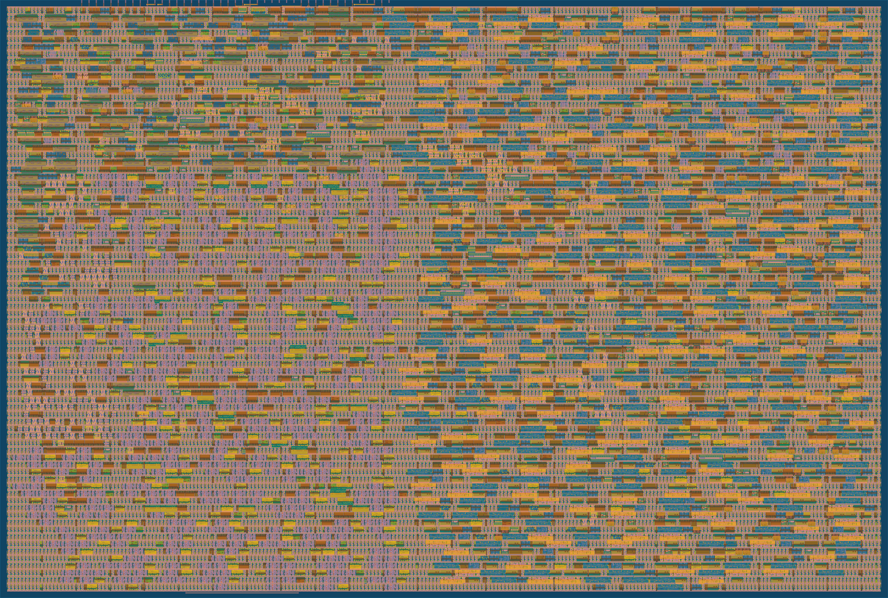

# Quad Branch Predictor

Four branch predictors on one small chip: the **perceptron** from Tiny Tapeout design #704, a **bimodal** table,
**gshare** and a **tournament** that picks between bimodal and gshare. They share one set of pins and see the same
branches, so every branch of a program is predicted four times and the predictors can be compared directly.

The same Verilog is

- **hardened for silicon**: SKY130, Tiny Tapeout 2×2 tiles, 4,701 cells, 47,096 µm², timing met at 50 MHz in every
  corner, DRC/LVS clean ([chip repository](https://github.com/Kyrylo-Nazarevych/tt-branch-predictor),
  [3D layout viewer](https://kyrylo-nazarevych.github.io/tt-branch-predictor/)), and
- **running on an FPGA** (Digilent Nexys 4 DDR) with a PC that replays the branches of any C program over USB and
  checks every answer against bit-exact Python models of the four predictors: **0 differences** on every trace so far.



## What's in the repository

| Folder | What |
|---|---|
| [`rtl/`](rtl) | The chip: `project.v` (top `tt_um_kyrylo_nazarevych_bp`), `perceptron_704.v`, `latch_memory.v`, `predictors.v` |
| [`test/`](test) | cocotb test: replays a 1,271-branch trace through the pins and checks all four predictors |
| [`fpga/`](fpga) | Board design (wrapper, 1 Mbaud UART, display), Vivado scripts, host tools, live dashboard. [README](fpga/README.md), [demo guide](fpga/DEMO_GUIDE.md) |
| [`tools/`](tools) | C program → RISC-V → Spike → branch trace (`bptrace`), statistics, the Streamlit analysis app, 45 precomputed traces. [README](tools/README.md) |
| [`verification/`](verification) | Reference traces with expected predictions, Python models, compare and parameter-sweep tools. [README](verification/README.md) |
| `.vscode/` | Tasks and launch configurations for everything above |

## The chip in one table

| Predictor | Storage | Area (logic, SKY130) | Answers | `sort_and_search -O1` | Alternating T/N branch |
|---|---|---|---|---|---|
| Perceptron (704) | 8 × (bias + 7 weights) × 8 bit in a 64-byte latch RAM, 7-bit history | 16,879 µm² | 11 clocks; 11–45 with training | **84.48%** | 99.85% |
| Bimodal | 64 × 2-bit counters | 7,936 µm² | 2 clocks after the strobe | 84.07% | **50.00%** |
| gshare | 64 × 2-bit, PC[7:2] ⊕ 8-bit history folded to 6 bits | 7,948 µm² | 2 clocks | 82.83% | 99.90% |
| Tournament | 64 × 2-bit chooser over bimodal and gshare | 22,948 µm² (all three tables) | 2 clocks | 83.48% | 99.85% |

More programs and what each predictor can and can't learn: [fpga/DEMO_GUIDE.md, section 3](fpga/DEMO_GUIDE.md).

## Pins and protocol

| Pin | Meaning |
|---|---|
| `ui_in[7:0]` | PC[7:0] of the branch |
| `uio_in[0]` | new-branch strobe (rising edge) |
| `uio_in[1]` | the real outcome (1 = taken) |
| `uo_out[0]` / `[1]` | perceptron prediction ready / perceptron prediction |
| `uo_out[2]` | training done: send the next branch |
| `uo_out[3]` | memory reset done (one-clock pulse, ~128 clocks after reset) |
| `uo_out[4]` / `[5]` / `[6]` | bimodal / gshare / tournament prediction |

Per branch: put the PC and outcome on the pins, pulse the strobe for one clock, **hold both stable**, wait for
`uo_out[0]`, read the four predictions (each made *before* that branch trains the predictor), then wait for
`uo_out[2]`. `fpga/sim/tb_team.v` and `test/` do exactly this.

## Quick start

### 1. Simulate the chip (Icarus Verilog)

```bash
cp verification/traces/ref704_committed_log/trace_init.vh fpga/sim/
cd fpga/sim && iverilog -g2012 -o tbteam tb_team.v ../../rtl/project.v ../../rtl/perceptron_704.v ../../rtl/latch_memory.v ../../rtl/predictors.v && vvp -n tbteam | grep -E "SUMMARY|RESULT"
```

Expected: `acc_perceptron=81.98 acc_bimodal=66.88 acc_gshare=86.47 acc_tournament=88.83 avg_cycles=25.6` and
`VULKOS_RESULT: PASS`. The cocotb version: `cd test && make` (needs `pip install cocotb`).

### 2. Run it on a Nexys 4 DDR (Windows, Vivado 2024.2)

```powershell
python -m venv fpga\.venv; fpga\.venv\Scripts\pip install -r requirements.txt
.\fpga\fpga.ps1 build -Ram latch           # bitstream in about 2.5 minutes
.\fpga\fpga.ps1 program -Ram latch         # board on J6 (PROG micro-USB)
fpga\.venv\Scripts\python.exe fpga\host\bphost.py ping
fpga\.venv\Scripts\python.exe fpga\host\bphost.py runall          # every trace, compared with the models
fpga\.venv\Scripts\python.exe fpga\host\bpdash.py                 # live dashboard: http://localhost:8765
```

No board? `bpdash.py --mock` runs the dashboard against a Python stand-in with the same protocol and numbers.

### 3. Analyse your own C program

```powershell
fpga\.venv\Scripts\python.exe -m streamlit run tools/app/app.py      # http://localhost:8501
```

The 45 precomputed traces work right away. Compiling new C code needs the RISC-V GCC and Spike, installed once with
`bash tools/scripts/setup_toolchain.sh` (Ubuntu 24.04 or WSL, about 15 minutes); see [tools/README.md](tools/README.md).

## Porting to another FPGA board

The chip RTL needs nothing board-specific. Only the wrapper does:

1. **Constraints:** write your board's `.xdc` (or equivalent) for the ports of `fpga/hdl/fpga_top.v`: clock, an
   active-low reset button, UART RX/TX, and optionally the LEDs, switches and 7-segment display. You can tie unused
   display outputs off or remove `board_ui.v`.
2. **Clock:** `fpga_top.v` turns a 100 MHz input into 25 MHz with an `MMCME2_BASE` (`CLKFBOUT_MULT_F = 10`,
   `CLKOUT0_DIVIDE_F = 40`). Change these for another input clock, or use your vendor's PLL. The chip itself meets
   50 MHz in SKY130's slow corner, so 25 MHz is very safe.
3. **UART:** 1 Mbaud 8N1 by default (`CLKS_PER_BIT = 25` at 25 MHz). For a USB-UART that can't do 1 Mbaud, build with
   another `BAUD` and pass the same rate to `bphost.py`/`bpdash.py`.
4. **Define `SIM`** for FPGA synthesis (`build.tcl` does). Without it `rtl/latch_memory.v` instantiates three SKY130
   cells that only exist in the ASIC flow.
5. **The latch RAM** becomes 512 level-sensitive latches with logic-driven enables. It works on the Artix-7; if your
   tool or device dislikes it, build with `fpga/hdl/bp_latch_mem_ff.v` instead (same module and cycle behaviour,
   flip-flop storage): `-Ram ff`.
6. Check with `fpga.ps1 sim` (Vivado's simulator) or your simulator before touching the board, then
   `bphost.py runall`: every trace must report 0 differences.

## Verification status

- RTL against the Python models: identical on all reference traces (70,196 branches × 4 predictors) in Icarus and in
  Vivado's simulator; the 704 design's original 13 cocotb tests pass on the modified core.
- ASIC flow (LibreLane, Tiny Tapeout CI): layout, precheck and gate-level simulation pass.
- FPGA: every trace replayed on the board, both RAM builds, byte-identical to simulation.

## License and credits

Apache License 2.0, see [LICENSE](LICENSE) and [NOTICE](NOTICE).

Built by Kyrylo Nazarevych, Märten Erik Loor, Ilma Kule and Vitalii Haponenko (Chipathon, October 2026), on the work
of others:

- the perceptron predictor is Tiny Tapeout design #704 by Tristan Robitaille
  ([tt_branch_pred](https://github.com/TristanRobitaille/tt_branch_pred), Apache-2.0);
- its latch RAM is by Michael Bell ([tt06-memory](https://github.com/MichaelBell/tt06-memory), Apache-2.0);
- the Nexys 4 DDR master constraints are Digilent's ([digilent-xdc](https://github.com/Digilent/digilent-xdc), MIT);
- branch traces come from the [Spike](https://github.com/riscv-software-src/riscv-isa-sim) RISC-V simulator.
